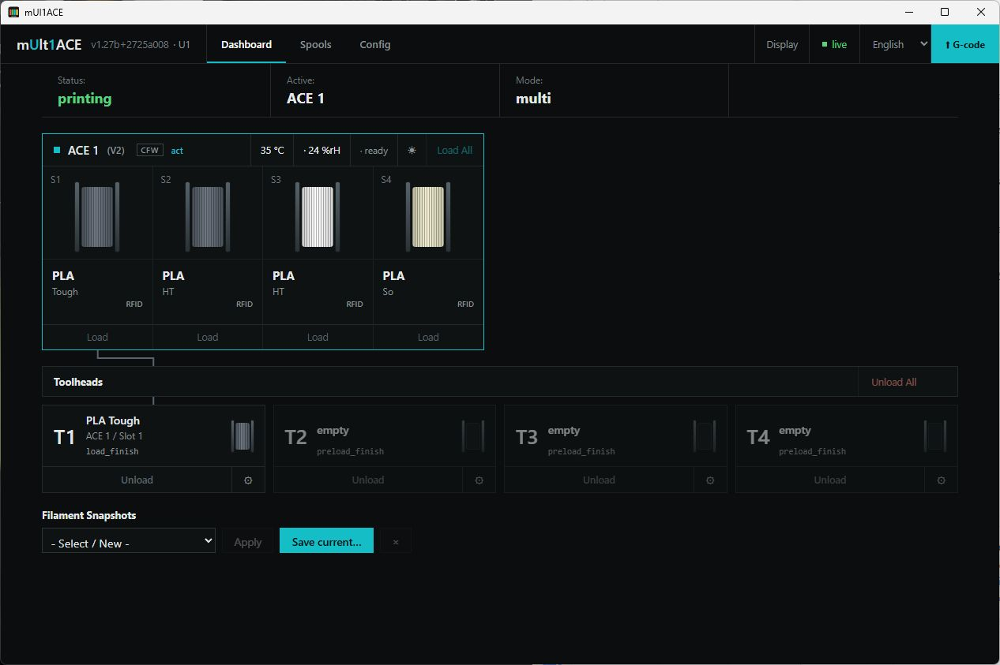
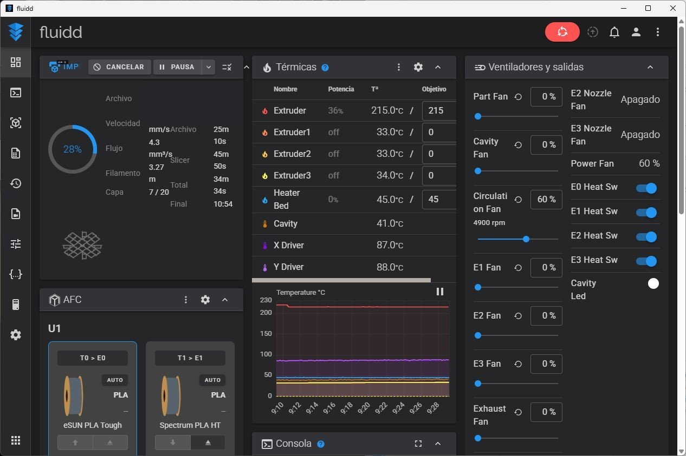
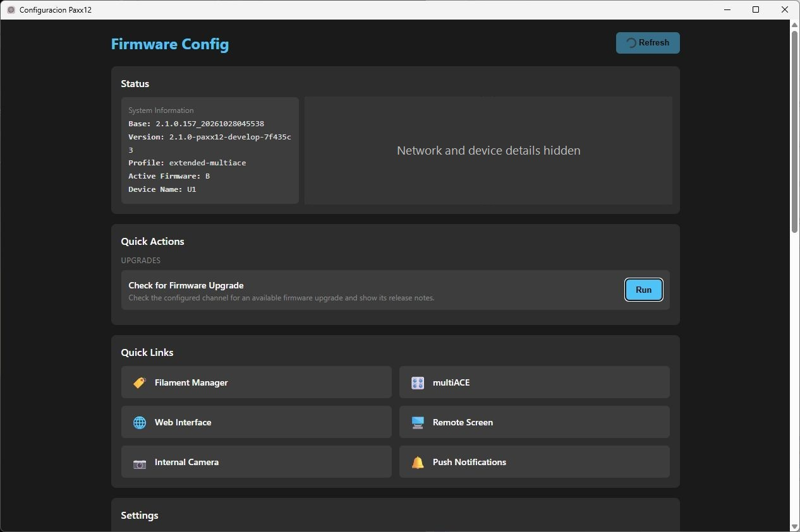
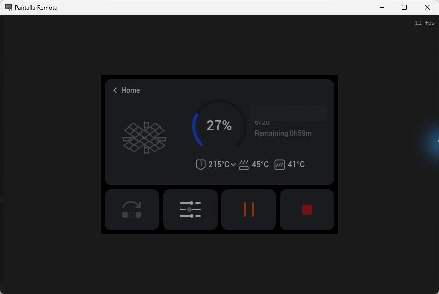
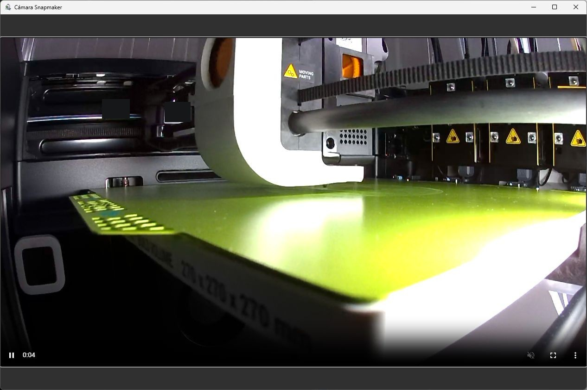
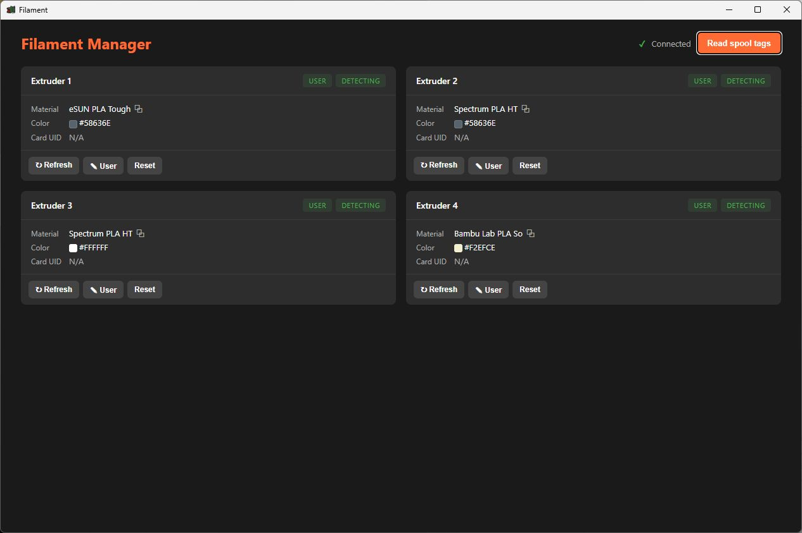

# Paxx12 Desktop Suite for Snapmaker U1

Paxx12 is a set of lightweight Windows desktop applications that open the Snapmaker U1's local web interfaces in separate, branded windows. Each shortcut launches one interface, so the printer's main controls, ACE tools, remote display, camera, and filament tools can be opened independently from the Start menu.

The installer asks for the printer's IP address once and applies it to all six applications. It installs them in `C:\Program Files\Paxx12` and groups their shortcuts under **Paxx12** in the Start menu.

## Applications

### mUl1ACE

Opens the MultiACE interface for the U1. Its dashboard shows ACE status and slots, toolhead assignments, filament information, and filament snapshots. It also provides the controls exposed by MultiACE for loading and unloading filament.

### Fluidd

Opens Fluidd, the printer's web interface. It provides print monitoring and printer controls, including temperatures, fans, the console, and job progress.

### Configuracion Paxx12

Opens the Paxx12 firmware configuration page. It displays firmware and device information, provides firmware update checks, and links to the other U1 interfaces and settings.

### Pantalla Remota

Opens the U1's remote screen interface, showing the touchscreen view and the controls available there, such as pause and stop during a print.

### Cámara Snapmaker

Opens the printer's WebRTC camera stream in its own window for a live view of the print area.

### Paxx12 Filament

Opens the Filament Manager page. It displays the material and color information reported for each extruder and provides controls to read spool tags, refresh the displayed data, or set user filament information.

> Screenshots were captured from a connected printer. Local network and device details, print-file names, and camera label codes have been obscured.

## Installation

1. Run `Paxx12-Instalador.exe` and approve the Windows administrator prompt.
2. Enter the IPv4 address of the Snapmaker U1 when prompted.
3. The installer creates six desktop applications and Start menu shortcuts in the **Paxx12** group.

Alternatively, extract `Paxx12-Instalador.zip` and run `Instalar-Paxx12.cmd`.

The application windows load the interfaces from the printer over the local network; the web interfaces themselves are hosted by the printer.

## Requirements

- Snapmaker U1 running Paxx12 mUlt1ACE firmware
- Windows x64
- Microsoft Edge WebView2 Runtime
- A network connection from the PC to the printer

## Distribution files

- `Paxx12-Instalador.zip` — installer files and command-line launcher with an IP prompt
- `Paxx12-Instalador.exe` — self-extracting installer with the same IP prompt
- `Paxx12-Programas.zip` — application files
